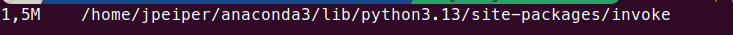

# Gestores de dependencias y tareas (Issue #21)

En Go, el gestor de dependencias estándar y nativo es `go mod`. Al ser el estándar oficial del lenguaje desde la versión 1.16, además no requiere instalación externa.

Para elegir el gestor de tareas del proyecto he evaluado cuatro alternativas: **Make** (estándar POSIX), **Tusk** (YAML escrito en Go), **Robo** (YAML escrito en Go) e **Invoke** (gestor de tareas en Python). Los criterios objetivos medidos son:

- Tiempo de instalación usando el instalador binario oficial más rápido disponible.
- Tiempo de arranque y gestión al lanzar la misma tarea `check` ejecutando `go build ./...` en la raíz del proyecto.
- Tamaño del binario instalado en disco.
- Tamaño del fichero de configuración mínimo para definir la misma tarea.

## Pruebas objetivas

En primer lugar, he medido el tiempo que tarda cada herramienta en instalarse en el sistema mediante `time`:

Make es el único que no tiene captura ya que viene preinstalado en Linux.

A continuación, he lanzado `time <herramienta> check` ejecutando `go build ./...`:

Resultados de las pruebas:

* **Make:** viene preinstalado en el sistema (0s de instalación), su binario ocupa 254 KB, el Makefile de `check` ocupa 22 bytes y ejecuta la comprobación en 0.019s.
* **Tusk:** tarda 5.582s en instalarse con `go install`, ocupa 7.9M, su fichero de configuración ocupa 44 bytes y ejecuta `check` en 0.019s.
* **Robo:** tarda 4.226s en instalarse con `go install`, ocupa 5.6M, su fichero de configuración ocupa 32 bytes y ejecuta `check` en 0.016s.
* **Invoke:** tarda 1.740s en instalarse mediante `pip`, ocupa 1.5M, su fichero ocupa 76 bytes y ejecuta `check` en 0.127s.

*Decisión:* He elegido usar **Make** porque es la que mejor resultado obtiene en todo lo que ha sido evaluado menos en la ejecución del check en la cual gana Robo por 0.003s. He dudado con usar Robo por esto mismo pero creo que no merece la pena ya que en todo lo demás Make sale ganando y 0.003s no hace la diferencia como para elegir a Robo solo por ello.