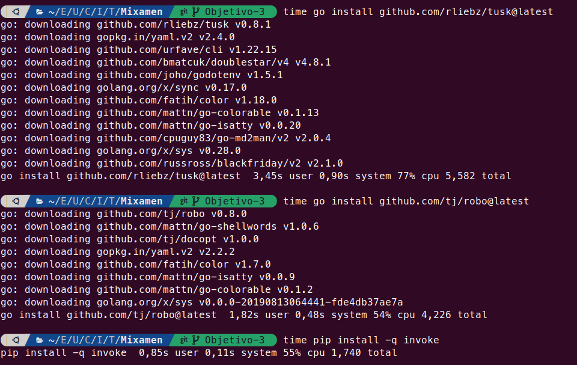
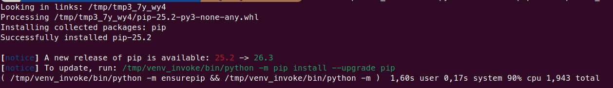
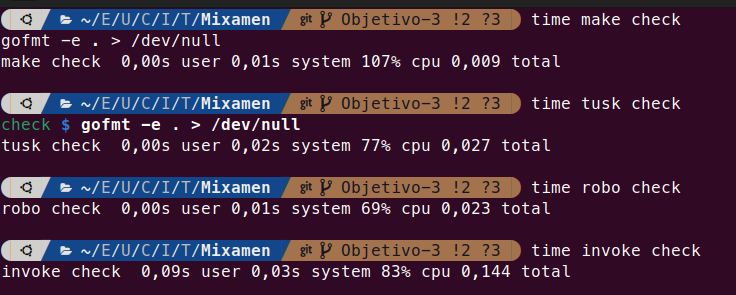

# Gestores de dependencias y tareas (Issue #21)

En Go, el gestor de dependencias estándar y nativo es `go mod`. Al ser el estándar oficial del lenguaje desde la versión 1.16, además no requiere instalación externa.

Para elegir el gestor de tareas del proyecto he evaluado cuatro alternativas: **Make** (estándar POSIX), **Tusk** (YAML escrito en Go), **Robo** (YAML escrito en Go) e **Invoke** (gestor de tareas en Python). Los criterios objetivos medidos son:

- Tiempo de instalación usando el método oficial más directo en Linux (en un entorno Go).
- Tiempo de arranque y ejecución al lanzar la misma tarea `check` ejecutando `gofmt -e . > /dev/null` en la raíz del proyecto.

## Pruebas objetivas

En primer lugar, he medido el tiempo que tarda cada herramienta en instalarse en el sistema mediante `time`:

Make es el único que no tiene captura ya que viene preinstalado en Linux.

A continuación, he lanzado `time <herramienta> check` ejecutando `go gofmt -e . > /dev/null`:

Resultados de las pruebas:

* **Make:** viene preinstalado en el sistema (0s de instalación) y ejecuta `check` en 0.009s.
* **Tusk:** tarda 5.582s en instalarse con `go install` y ejecuta `check` en 0.027s.
* **Robo:** tarda 4.226s en instalarse con `go install` y ejecuta `check` en 0.023s.
* **Invoke:** tarda 1.943s en instalarse `pip` y la herramienta, y ejecuta `check` en 0.144s.

*Decisión:* He elegido usar **Make** porque es la que mejor resultado, no tiene que instalarse y además ha tenido el mejor tiempo de ejecución.