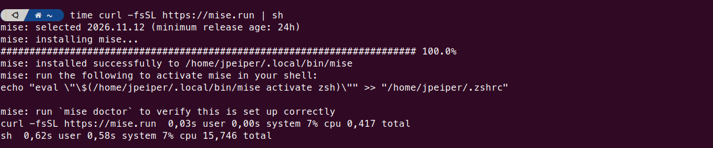
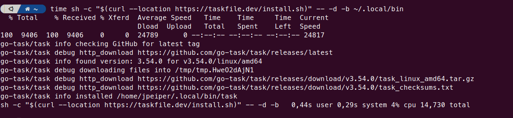
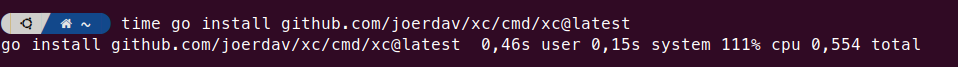
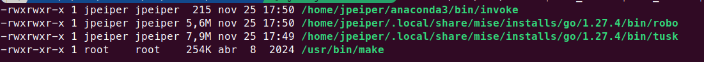
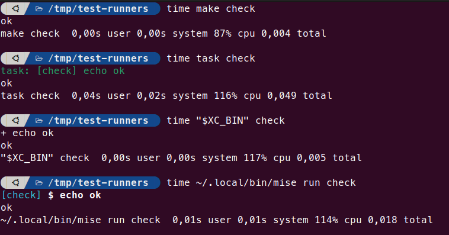

# Gestores de dependencias y tareas (Issue #21)

En Go, el gestor de dependencias estándar y nativo es `go mod`. Al ser el estándar oficial del lenguaje desde la versión 1.16, además no requiere instalación externa.

Para elegir el gestor de tareas del proyecto he evaluamado cuatro alternativas: **Make** (estándar POSIX), **Task** (escrito en Go), **Xc** (herramienta emergente escrita en Go basada en Markdown) y **Mise** (herramienta escrita en Rust). Los criterios objetivos medidos son:

- Tiempo de instalación usando el instalador binario oficial más rápido disponible.
- Tiempo de arranque y gestión (*overhead*) al lanzar una tarea mínima idéntica con `echo ok`, aislando el rendimiento de la herramienta del tiempo de compilación de Go.
- Tamaño del binario instalado en disco.
- Tamaño del fichero de configuración mínimo para definir la misma tarea.

## Pruebas objetivas

En primer lugar, he medido el tiempo que tarda cada herramienta en instalarse en el sistema mediante `time`:





Make es el único que no tiene captura ya que viene preinstalado en Linux.

A continuación, he lanzado `time <herramienta> check` con una tarea mínima que imprime un simple `echo` para medir exclusivamente el tiempo de sobrecarga (*overhead*) de cada gestor, estas eran las configuraciones de cada archivo para dicha tarea junto con lo que ocupaban:

- `Makefile` (17 bytes):
  ```makefile
  check:
  	@echo ok
  ```
- `Taskfile.yml` (43 bytes):
  ```yaml
  version: '3'
  tasks:
    check:
      - echo ok
  ```
- `README.md` para `xc` (37 bytes):
  ```markdown
  # Tasks

  ## check

  ```sh
  echo ok
  ```
- `mise.toml` (30 bytes):
  ```toml
  [tasks.check]
  run = "echo ok"
  ```





*Tabla para comparar herramientas según los requisitos:*

| Requisito Objetivo | Make | Task | Xc | Mise |
| :--- | :--- | :--- | :--- | :--- |
| **Tiempo de instalación** | 0s (Preinstalado) | 14,730s | 0,554s | 15,746s |
| **Tiempo de ejecución** | 0.004s | 0.049s | 0.005s | 0.018s |
| **Tamaño herramienta** | 254 KB | 50 MB | 8.4 MB | 184 MB |
| **Tamaño configuración** | 17 B | 43 B | 37 B | 30 B |

*Decisión:* He elegido usar **Make** porque es la que mejor resultado obtiene en todo lo que ha sido evaluado.