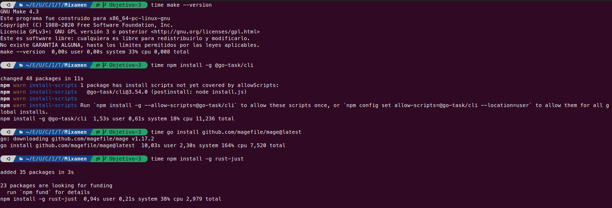

# Gestores de dependencias y tareas (Issue #21)

En Go, el gestor de dependencias estándar y nativo es `go mod`. Al ser el estándar oficial del lenguaje desde la versión 1.16, además no requiere instalación externa.

Para el gestor de tareas he desarrollado los siguientes requisitos:

- Que no añada herramientas de terceros
- Que se instale y ejecute de forma rápida
- Que a la hora de integrar nuevos desarrolladores suponga el menor problema posible
- Que sea lo más ligera posible en cuanto a peso y en cuanto a líneas necesarias para una misma tarea

Para ello he comparado cuatro de los principales gestores de tareas del ecosistema: **Make**, **Task**, **Just** y **Mage**.

## Pruebas objetivas

En primer lugar, he medido el tiempo que tarda cada herramienta en instalarse en el sistema mediante `time`:

A continuación, he lanzado `time <herramienta> check` con una tarea mínima que imprime un simple `echo` para medir exclusivamente el tiempo de sobrecarga (*overhead*) de cada gestor:

*Tabla para comparar herramientas según los requisitos:*

| Requisito Objetivo | Make (`Makefile`) | Task (`Taskfile.yml`) | Just (`justfile`) | Mage (`magefile.go`) |
| :--- | :--- | :--- | :--- | :--- |
| **Tiempo de instalación** | 0s (Preinstalado) | 11.236s | 2.979s | 7.520s |
| **Tiempo de ejecución** | 0.010s | 0.130s | 0.141s | 0.173s |
| **Dependencia Terceros** | Preinstalado en Linux y Mac | Descarga externa en cualquier sistema | Descarga externa en cualquier sistema | Descarga externa (`go install`) |
| **Integración desarrolladores** | Configuración cero | Requiere paso de instalación | Requiere paso de instalación | Requiere paso de instalación |
| **Ligereza de herramienta** | ~250 KB | ~15 MB | ~4 MB | Requiere compilar binario Go |
| **Ligereza de configuración** | 2 líneas | 5 líneas | 2 líneas | 7 líneas |

*Decisión:* He elegido **Make** porque, como se aprecia en las capturas, ya viene preinstalado en el sistema (tiempo de instalación 0s) mientras que Task, Just y Mage requieren descargas e instalaciones adicionales. Además, Make ofrece el tiempo de ejecución más bajo (0.010s frente a más de 0.13s del resto) y la configuración más ligera, facilitando que cualquier persona nueva que trabaje en este proyecto pueda usar el gestor de tareas desde el primer momento sin instalar nada adicional.